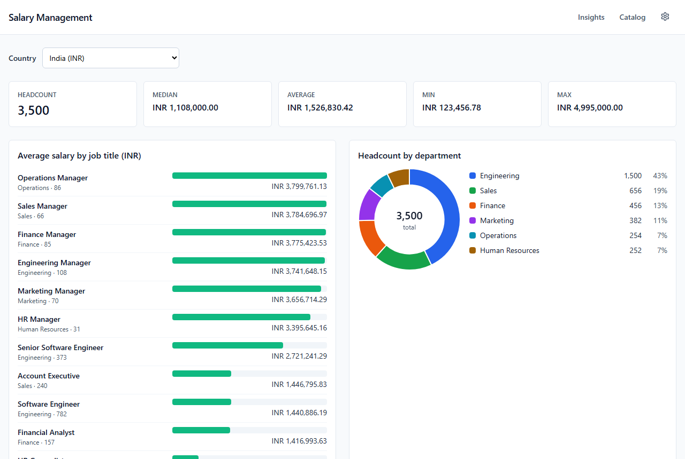
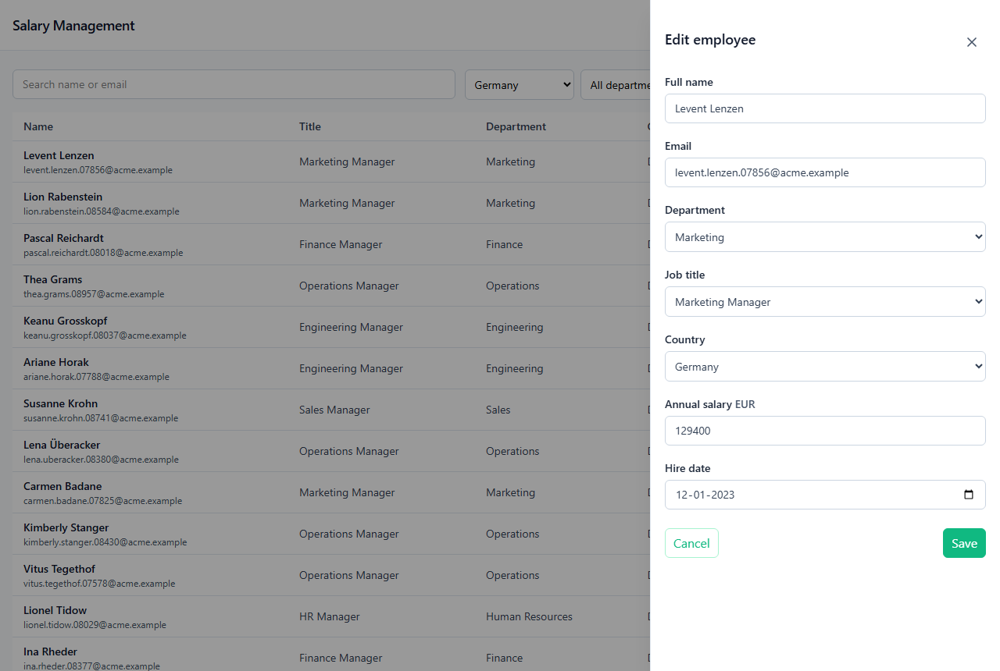
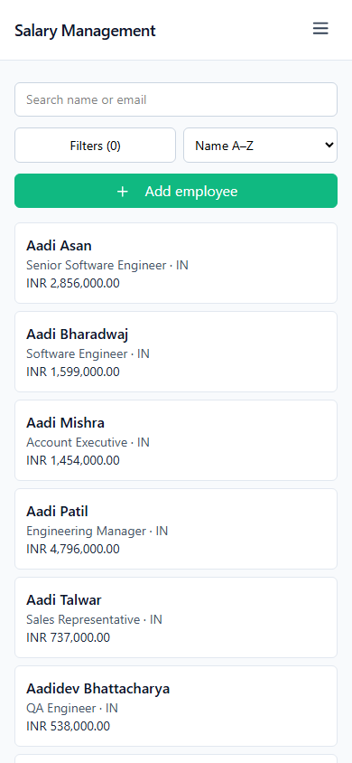

# Salary Management

A web app for an HR Manager who looks after salaries for about 10,000 employees across five countries.
It replaces spreadsheets with one place to find and update anyone's salary, and to answer **"How does the
organization pay people?"** per country, in local currency.



## Live

| | Production | Stage |
|---|---|---|
| App | https://salary-management-ivory-psi.vercel.app | https://salary-management-stage.vercel.app (behind Vercel login) |
| Health page | https://salary-management-ivory-psi.vercel.app/health | https://salary-management-stage.vercel.app/health |
| API health | https://salary-management-api-tzf8.onrender.com/actuator/health | https://salary-management-api-stage.onrender.com/actuator/health |

**The first request can take up to a minute.** The API runs on Render's free tier, which stops the
container after about 15 minutes idle, and the Neon database suspends too. The app says "Waking the
server… this can take up to a minute" instead of showing a silent spinner (ADR-004). Once warm, a list
answers in about 114 ms and a country's insights in about 79 ms, measured from India
([`PERFORMANCE.md`](docs/PERFORMANCE.md)). Production holds 10,000 seeded, made-up employees.

## What it does

| Requirement ([`REQUIREMENTS.md`](REQUIREMENTS.md)) | How | Evidence |
|---|---|---|
| Find any employee and update their salary in under 30 seconds | Catalog → search (debounced) → click → Edit → Save: five interactions, each warm response well under 200 ms | Playwright path "find and update a salary", desktop and phone |
| Add, view, edit and delete; currency derived from the country | One drawer for view, add and edit; delete with confirmation | `employee-drawer.spec.ts`, `employee-delete.spec.ts` |
| Validation: required, valid email, salary > 0, hire date not in the future, supported countries | In the API (Bean Validation, one pass, every error at once) and mirrored in the form | ADR-010, ADR-037 |
| A stale edit is rejected, not silently overwritten | Optimistic locking: 409 `STALE_VERSION`; the form keeps your edits and blocks Save until you reload | ADR-023, ADR-041, ADR-051 |
| Paginated list with search, filters and sorting; filters in the URL | Server-side paging, name-or-email search on trigram indexes; the URL is the only source of list state | ADR-016, ADR-044, ADR-051 |
| Min, max, average and median per country; average by job title; headcount by department | One call per country, every statistic aggregated in SQL, an exact median | ADR-017, ADR-022, ADR-047 |
| Insights in under 1 second | 0.4–3 ms on the database server; 79 ms live, warm | [`PERFORMANCE.md`](docs/PERFORMANCE.md) |
| Deterministic, idempotent seed of 10,000 employees, in under 10 seconds | A `seed` Spring profile; 2–4 s locally, on stage and in production | ADR-049 |
| Default country for Insights (added during design) | A backend setting, India until changed | ADR-028 |

<p>
  
  
</p>

## Stack

- **Backend:** Java 21, Spring Boot 4, PostgreSQL 18 (Neon), Flyway; JUnit 5, Mockito, AssertJ and
  Testcontainers. Hosted on Render.
- **Frontend:** Angular 21 (standalone components, signals, zoneless), PrimeNG with Tailwind, Chart.js;
  Vitest and Playwright. Hosted on Vercel.
- **Contract:** [`openapi.yaml`](docs/openapi.yaml), written before the code; every error is RFC 7807
  Problem Details with a stable code.

## Run it locally

Needs Docker, Java 21 and Node 22.

```bash
docker compose up -d                                   # Postgres on port 5433
cd backend
./mvnw spring-boot:run -Dspring-boot.run.profiles=seed # seed 10,000 employees (safe to re-run)
./mvnw spring-boot:run                                 # API on http://localhost:8081
cd ../frontend
npm ci && npm start                                    # app on http://localhost:4200
```

The defaults match docker compose, so no environment variables are needed locally. Deployed environments
set `DB_URL`, `DB_USERNAME`, `DB_PASSWORD` and `CORS_ALLOWED_ORIGINS`. On Windows, use `mvnw.cmd`.

## Tests

| What | Command | Count |
|---|---|---|
| Backend: unit, slice and Testcontainers tests (needs Docker) | `cd backend && ./mvnw test` | 324 |
| Frontend: unit and component tests (Vitest, jsdom) | `cd frontend && npx ng test --watch=false` | 137 |
| End-to-end: 2 paths at desktop and phone width, against the seeded local stack | `cd frontend && npx playwright test` (backend running) | 4 |
| Lint and format | `cd frontend && npm run lint && npm run format:check` | — |

CI runs all of them on every push. Production and stage deploy only after every check passes (ADR-034,
ADR-052). More commands are in [`CLAUDE.md`](CLAUDE.md).

## How it was built

Requirement first, then design, then small test-first slices; every decision written down.

- **[`DECISIONS.md`](docs/DECISIONS.md):** 53 architecture decision records, each with the options that
  were rejected and why. Start with its reading guide.
- **[`WORKFLOW.md`](docs/WORKFLOW.md):** the loop from requirement to shipped, and a guide to reading the
  commit history, blemishes included.
- **[`AI_USAGE.md`](docs/AI_USAGE.md):** how AI was used (an AI that asks before it builds, and an
  independent AI reviewer at every step), where it was wrong, and where the engineer chose differently.
- **[`prompts/`](docs/prompts/):** the prompt, decisions and approved test list behind every slice.
- **Design:** [`DATA_MODEL.md`](docs/DATA_MODEL.md), [`ARCHITECTURE.md`](docs/ARCHITECTURE.md),
  [`UI_DESIGN.md`](docs/UI_DESIGN.md); history in [`CHANGELOG.md`](CHANGELOG.md).

Every slice deploys to stage; production is promoted from stage once per phase (ADR-030).

## Limits and what is out of scope

- **Cold starts** on the free tier, described above.
- **One trusted HR user, no login.** Settings are app-wide.
- **Deliberately out of scope** ([`REQUIREMENTS.md`](REQUIREMENTS.md)): authentication and roles, salary
  history, cross-country comparison, payroll, bulk import and export, approval workflows. Each row says
  how it would be added.
