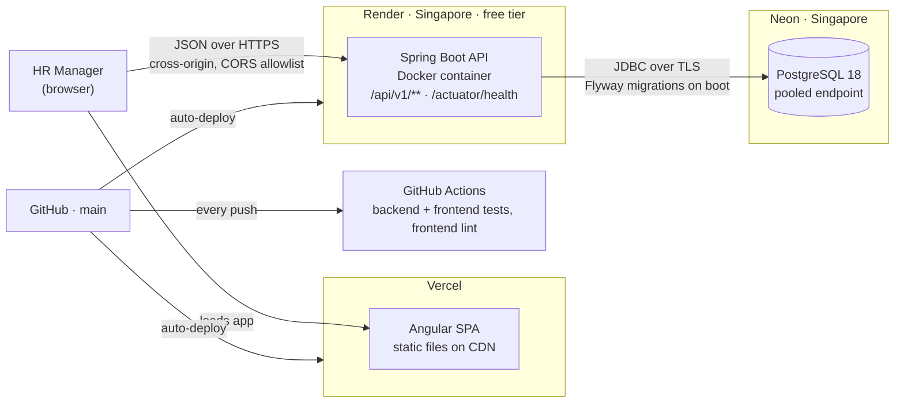
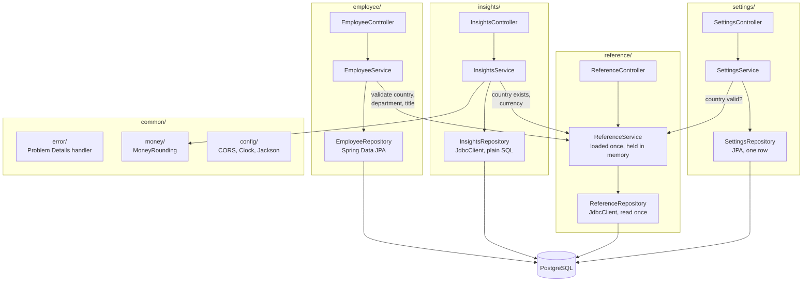
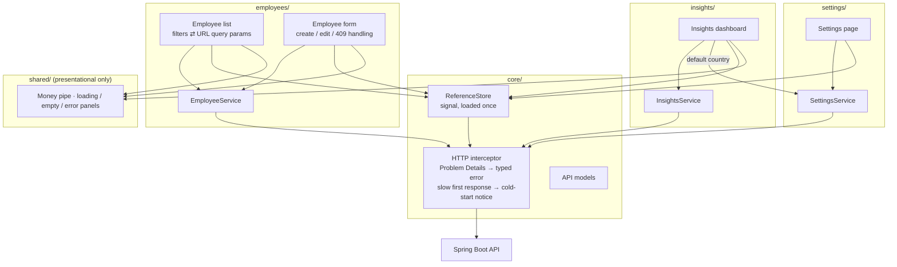
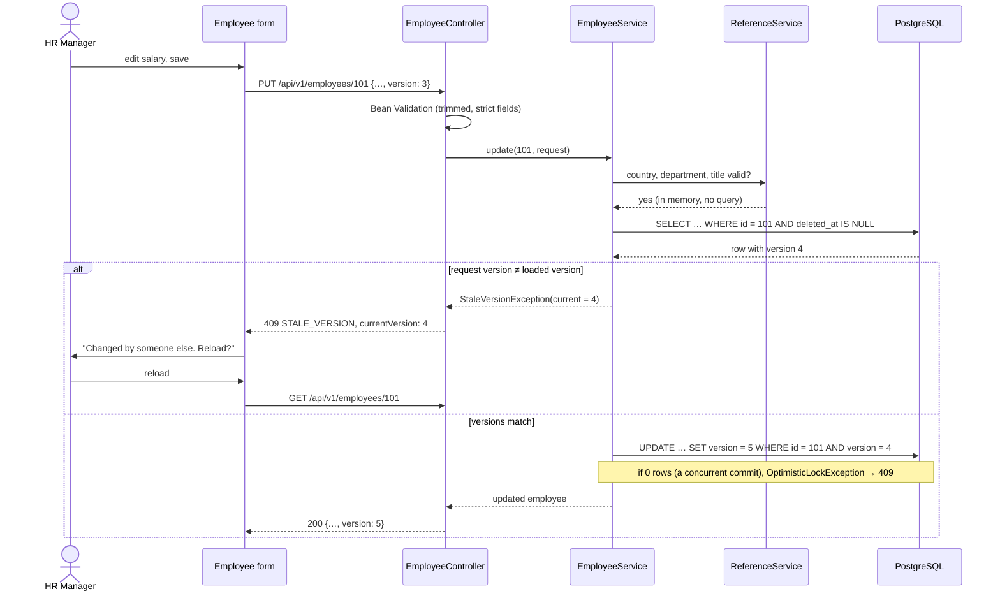
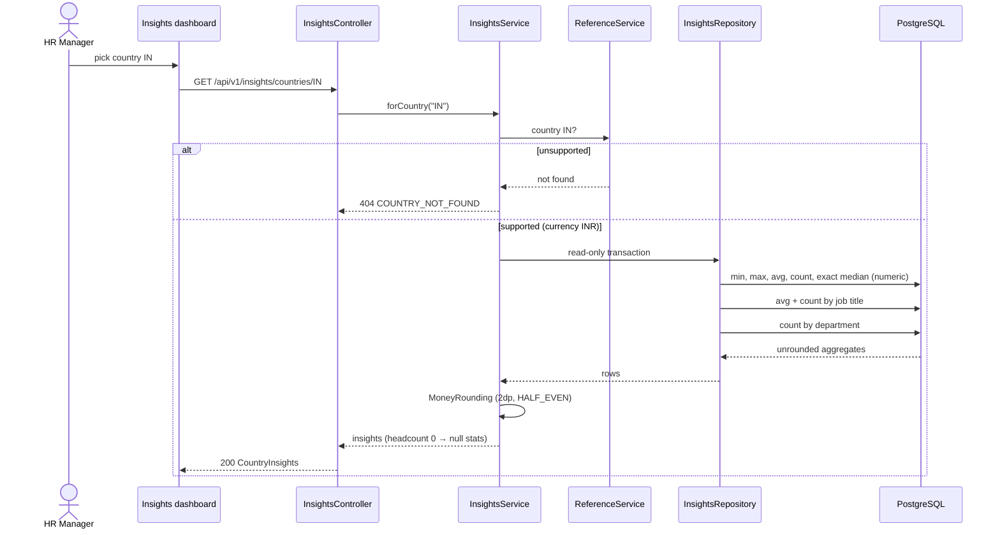

# Architecture

How the system is deployed and how the code is organised. This is the design from task 2.4: phase 1's
skeleton exists, and the feature code arrives in phases 3 to 7. Decisions behind each part are linked;
the structure itself is ADR-026.

Related: [data model](DATA_MODEL.md) · [API contract](openapi.yaml) · [decisions](DECISIONS.md)

## 1. Deployment



| Element | Notes | Decision |
|---|---|---|
| Browser to API | Direct cross-origin calls; allowed origins come from `CORS_ALLOWED_ORIGINS` | ADR-003 |
| API | Sleeps after about 15 minutes idle, and the first request waits up to a minute | ADR-004 |
| Database | Free tier; autosuspends; pooled endpoint because of connection limits; same region as the API | ADR-002 |
| Config | Every secret and URL is an env var (`DB_URL`, `DB_USERNAME`, `DB_PASSWORD`, `CORS_ALLOWED_ORIGINS`, `PORT`) | `CLAUDE.md` |
| Health | `/actuator/health` includes the datasource, so UP proves the whole chain. Render uses it to gate deploys | 1.10 |
| Stage | The same three tiers again for the `stage` branch: a Vercel branch deploy, a second Render service, and a Neon branch database. Promoted to `main` once per phase | ADR-030, 1.11 |

## 2. Backend components

Packages are grouped **by feature**, with the `controller → service → repository` layers inside each one.



```
com.acme.salary
├─ employee/    EmployeeController, EmployeeService, EmployeeRepository, Employee (entity), dto/, validation/
├─ insights/    InsightsController, InsightsService, InsightsRepository, dto/
├─ reference/   ReferenceController, ReferenceService, ReferenceRepository (JdbcClient), Country, JobTitle, dto/,
│               validation/ (@SupportedCountry, used by employee and settings) (ADR-037)
├─ settings/    SettingsController, SettingsService, SettingsRepository, AppSettings (entity), dto/ (ADR-028)
├─ seed/        SeedRunner (`seed` profile only), EmployeeGenerator (Datafaker), EmployeeSeeder (JdbcTemplate
│               batches), SeedCatalog; depends on no other feature (ADR-049)
└─ common/      error/ (Problem Details), money/ (MoneyRounding), config/ (CORS, Clock, Jackson)
```

**Rules.** These are enforced by convention and review, not by a test (ADR-026):

| Rule | Why |
|---|---|
| Controllers call only their own feature's service | Domain logic stays out of controllers (`CLAUDE.md`) |
| Entities never leave a service; controllers see DTOs | DTOs at the boundary (`CLAUDE.md`) |
| Features (`employee`, `insights`, `settings`) depend on `reference` and `common` only. `reference` depends on nothing but `common` | One direction, no cycles |
| Another feature is reached only through its public service, never its repository or entity | Internals stay package-private and changeable |
| `employee` uses JPA; `insights` uses `JdbcClient`; aggregation never happens in Java | ADR-022 |
| Every query on `employee` filters `deleted_at IS NULL` | ADR-011 |
| "Now" comes from an injected `Clock` (UTC) | ADR-010 |
| Money rounding happens only in `MoneyRounding` | ADR-021 |

**Reference data in memory.** `ReferenceService` reads countries, departments and titles once at
startup and keeps them in immutable maps. Validation on a write and the currency lookup for insights
cost no query. This is safe because reference data changes only through a migration, and a migration
means a redeploy and a restart. No caching library is used.

`CorsConfig` moved from the root package to `common/config` in task 3.2 (ADR-026).

## 3. Frontend components



```
src/app/
├─ core/       interceptor, cold-start detection, ReferenceStore, API models
├─ employees/  Catalog list, drawer (view/add/edit), delete confirmation, employee.service
├─ insights/   dashboard (landing page), insights.service
├─ settings/   settings page, settings.service (ADR-028)
├─ shared/     presentational UI only: money pipe, state panels
└─ health/     phase 1 health page (exists)
```

| Rule | Why |
|---|---|
| Components call feature services. Only services and `core/` touch `HttpClient` | `CLAUDE.md` |
| State is signals; components use `OnPush`; the app is zoneless | `CLAUDE.md`, ADR-007 |
| `shared/` holds no services and no HTTP | Keeps it from becoming a junk drawer |
| UI code formats money but never calculates with it | ADR-015 |
| The UI branches on the Problem `code`, never on the status or message text | ADR-018 |
| Whether API models are generated from `openapi.yaml` or written by hand | Decided in 7.1 (ADR-013) |

## 4. Key flows

### Update with a stale version → 409



(ADR-014, ADR-018, ADR-023)

### Country insights



(ADR-017, ADR-021, ADR-022)
