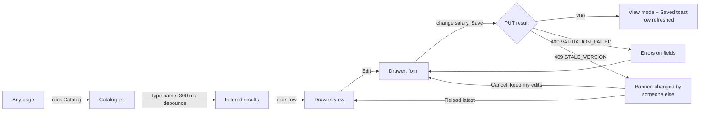
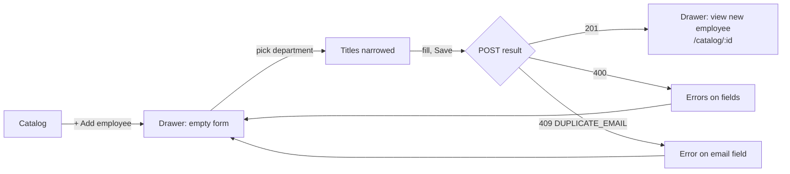
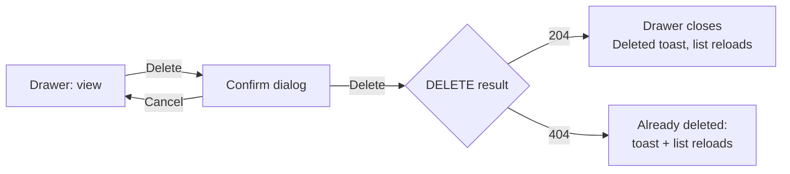
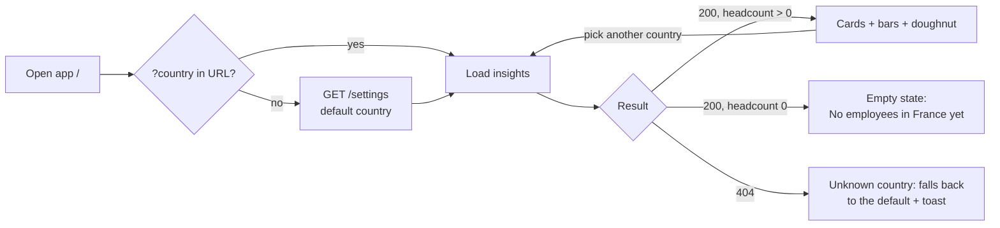
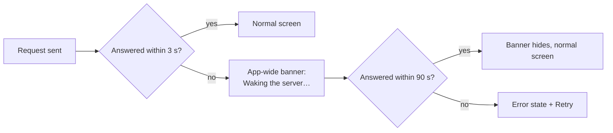

# UI Design

Screens, user flows and states for v1, designed in task 2.5 (ADR-027 to ADR-029) and redesigned in
tasks 8.8–8.12 (ADR-054, ADR-055). The behaviour rules below are those of 2.5 unless marked otherwise.
This is the source for phase 7: the API calls refer to [`openapi.yaml`](openapi.yaml), and the
structure to [`ARCHITECTURE.md`](ARCHITECTURE.md).

## Look

- **Palette:** a PrimeNG preset over Aura with indigo for primary (600 in light, 400 in dark) and slate
  for surfaces. The app's own colour tokens (`canvas`, `card`, `subtle`, `line`, `line-strong`, `ink`,
  `ink-muted`, `danger`, `danger-soft`, `danger-line`, `warn`, `warn-soft`, `warn-line`, `success`,
  `selected`) live in `styles.css` and switch with the theme. Templates use these and PrimeNG's `primary`
  and `primary-contrast`, never raw palette classes (ADR-054).
- **Theme:** System, Light or Dark from a toggle in the top bar, remembered per browser. An inline
  script in `index.html` applies it before Angular starts, so a dark page never flashes white.
- **Type:** Inter, self-hosted, with tabular figures for amounts and for counts that line up.
- **Motion:** 150–250 ms CSS transitions, the drawer slide and skeletons; the Insights bars grow in once
  over 600 ms. All of it is off under `prefers-reduced-motion`.
- **Accessibility:** axe (WCAG 2.1 AA, contrast included) checks Insights, the Catalog (filtered, and with the drawer in view mode) and Settings, in both themes, at desktop and phone width, in the
  End-to-end job. The add and edit form, the delete dialog and the empty and error states are not
  scanned.

## Navigation and routes

```
+-----------------------------------------------------------------+
| [◆] Salary Management   (Insights) Catalog               ⚙  ◐  |
+-----------------------------------------------------------------+
| Page title                                     [page actions]   |   <- sticky from 640 px
```

Phones keep the brand and the theme toggle in the top bar and move the links to bottom tabs:
`[Insights] [Catalog] [Settings]`. The ☰ menu of ADR-052 is gone (ADR-054).

| Route | Screen | Notes |
|---|---|---|
| `/` | **Insights dashboard** (landing page) | `?country=IN`. Country order: URL, then the saved default, then IN |
| `/catalog` | Catalog: the employee list | Filters, search, sort and page are all in the query string |
| `/catalog/new` | Catalog + drawer, add form | |
| `/catalog/:id` | Catalog + drawer, employee view | Linkable. A missing or deleted id shows "not found" in the drawer |
| `/catalog/:id/edit` | Catalog + drawer, edit form | |
| `/settings` | Settings | The default country for the dashboard |
| `/health` | Phase 1 health page | Exists already; not in the top bar |

"Catalog" is the label and the URL. The code folder stays `employees/` (`CLAUDE.md`), and the API stays
`/api/v1/employees`.

## Screens

### Insights dashboard (`/`)

Desktop (≥ 1024 px, four columns):
```
+-----------------------------------------------------------------+
| Insights                               Country [India (INR)  v] |
| +---------------------------+ +-------------+ +-------------+   |
| | Median salary             | | Headcount   | | Average     |   |
| | INR 1,108,000.00          | | 3,500       | | INR 1,526,… |   |
| |                           | +-------------+ +-------------+   |
| | Half of the 3,500 employ- | | Min         | | Max         |   |
| | ees in India earn this or | | INR 400,0…  | | INR 4,995,… |   |
| | less, and half this or …  | +-------------+ +-------------+   |
| +---------------------------+                                   |
| +---------------------------+ +-------------------------------+ |
| | Average salary by title   | | Headcount by department       | |
| | Operations Manager  INR … | |   (doughnut)  ● Eng 1,500 43% | |
| | Operations · 86           | |               ● Sales 656 19% | |
| | ███████████████           | |                               | |
| +---------------------------+ +-------------------------------+ |
+-----------------------------------------------------------------+
```

From 768 px it is two columns (the median and the breakdowns span both); below that, one column. The
wireframe truncates amounts for space; the screen shows them in full.

- **A bento grid.** The median leads in an indigo tile with a plain-words note; headcount, average, min
  and max sit beside it; the two breakdowns run below.
- **Money is shown in full, on one line**, in every tile. Container queries step the type down instead of
  wrapping, sized so the API's longest amount (`999,999,999,999.99`) fits; tested at 390, 768, 1024
  and 1280 px.
- **Average by job title** is a table with CSS bars (ADR-029): title and department · headcount on the
  left, the amount beside them, the bar below. Sorted by average, highest first (ADR-017).
- **Headcount by department** is a Chart.js doughnut (ADR-029) with the total in the centre and a legend
  of count and share. Its colours follow the theme (600s on white, 400s on slate-900, each at least 3:1).
- Changing the country updates `?country=` only. It does **not** change the saved default.

### Catalog (`/catalog`)

Desktop:
```
+---------------------------------------------------------------------------+
| Catalog                                               [+ Add employee]    |
| +-----------------------------------------------------------------------+ |
| | [Search name or email______] [Country v] [Department v] [Title v]     | |
| | (Country: India x) (Department: Engineering x)  Clear all             | |
| |-----------------------------------------------------------------------| |
| | Name ▲                  Title           Dept   Ctry  Salary    Hired  | |
| | (AR) Asha Rao           Software Eng.   Eng.   IN    INR 2,400… 2021… | |
| |      asha.rao@acme.example                                            | |
| |-----------------------------------------------------------------------| |
| | 1–20 of 1,500                      [<] 1 2 3 … 75 [>]   [20 v]/page   | |
| +-----------------------------------------------------------------------+ |
+---------------------------------------------------------------------------+
```

Phone: the same card with search, `[Filters (2)] [Sort v]`, the chips, then rows as avatar cards
(name, title · country, salary). The page header keeps Add employee.

- **Active filters show as chips** (ADR-054), each with a named remove button. Removing a chip clears only
  that filter; **Clear all**, and the empty state's **Clear filters**, clear country, department and job
  title and keep the search, sort and page size (task 8.10). Focus moves to the next chip, else the
  previous one; after Clear all, to the search box. With only a search and no matches, the empty state offers **Clear search** instead.
- **Rows and cards have initials avatars** (first and last name), hidden from screen readers.
- **The employee open in the drawer is marked:** `aria-current="true"` and a highlighted row.
- The column header does not stick (ADR-055); the page header does, from 640 px.
- **Search** is debounced (300 ms) and only sent at 2+ characters (ADR-016). One character shows the
  hint "Type at least 2 characters" and keeps the previous results.
- **Filters** have one value each. Picking a department narrows the title dropdown to that
  department's titles. Clearing the department restores all titles.
- **Sortable columns** are name, salary and hire date. Clicking a header toggles asc/desc. Other
  columns are not sortable, matching the API whitelist.
- **Page size** is 20, 50 or 100. Changing it, or any filter, resets to page 1.
- **The URL holds everything:** `/catalog?q=asha&country=IN&department=Engineering&sort=salary,desc&page=0&size=20`.
  The URL's page is 0-based to match the API; the paginator displays it 1-based.
- On phones, filters collapse into a "Filters (n)" panel and sorting moves to a "Sort" dropdown.
- **Invalid values in a link** (an unknown filter, a size other than 20/50/100, an unsupported sort, a
  one-character `q`, a bad or out-of-range page) are dropped or clamped, the URL is replaced, and a toast
  says part of the link was not recognised (ADR-051).

### Employee drawer (`/catalog/:id`, `/catalog/new`, `/catalog/:id/edit`)

```
+------------------------------+          +------------------------------+
|                            x |          | Edit employee              x |
| (AR) Asha Rao                |          | Person                       |
|      asha.rao@acme.example ⧉ |          |   Full name [Asha Rao_____]  |
|      [Engineering] · India   |          |   Email     [asha.rao@ac..]  |
| +--------------------------+ |          | Role                         |
| | Annual salary            | |          |   Department [Engineering v] |
| | INR 2,400,000.00         | |          |   Job title  [Software En v] |
| +--------------------------+ |          |   Hire date  [2021-04-12]    |
| Title      Software Engineer |          | Pay                          |
| Country          India · INR |          |   Country    [India       v] |
| Hired  2021-04-12 · 5 yrs 6… |          |   Salary INR [2400000.00__]  |
| [Edit]                       |          |------------------------------|
| Delete employee     [Delete] |          | [Cancel]             [Save]  | <- stays in view
+------------------------------+          +------------------------------+
          view                                   edit / add
```

- **Tenure** counts whole years and months to today (UTC, injected clock); a month counts once its day is
  reached. "Under a month" for a new hire.
- **Copy email** writes to the clipboard, and a polite live region says "Email copied", or "Couldn't copy
  the email".
- **Delete sits in a danger area** at the bottom of view mode, apart from Edit (ADR-054).
- The drawer opens on the right over the list, and the list keeps its filters and scroll. On phones
  it is full-screen.
- **One form component for add and edit.** Add starts empty at `/catalog/new`.
- **Currency** is shown next to the salary input and follows the selected country. It is never an
  input (ADR-014).
- **The title dropdown depends on the department.** Changing department clears the title.
- **Client validation mirrors the API:**
  - Required fields.
  - A valid email.
  - Salary > 0 with at most 2 decimals.
  - Hire date between 1950-01-01 and today in UTC; the date picker disables other dates.
  - Text lengths.

  Server `VALIDATION_FAILED` errors are mapped onto the same fields.
- **After a save,** the drawer switches to view mode with a "Saved" toast, and the list row refreshes.
  After an add, it shows the new employee at `/catalog/:id`.
- **Unsaved changes:** closing the drawer with edits asks "Discard changes?".

### Delete confirmation

```
+------------------------------------------------+
| Delete Asha Rao?                               |
| They will disappear from the catalog and from  |
| insights.                                      |
|                          [Cancel]  [Delete]    |
+------------------------------------------------+
```

The Delete button is in the drawer only, not on every row. After a delete, the drawer closes, a
"Deleted" toast appears, and the list reloads on the same page (or the previous one, if this emptied
it). There is no undo, because restore is not exposed (ADR-011).

### Settings (`/settings`)

```
+---------------------------------------------+
| Settings                                    |
| +-----------------------------------------+ |
| | Default country                         | |
| | Insights opens on this country.         | |
| | [India (INR)                v]   [Save] | |
| | Currency follows the country: INR       | |
| +-----------------------------------------+ |
+---------------------------------------------+
```

It uses `GET` / `PUT /api/v1/settings` (ADR-028). A stale save (409) shows "Settings were changed
elsewhere" and reloads them, since there is only one field to lose.

## User flows

### Find and update a salary (target: under 30 seconds)



After "keep my edits", the edits stay on screen but Save is disabled until "Reload latest" (ADR-051).
The "Discard changes?" prompt is a route guard: it covers the drawer buttons, the top-bar links, Back and
clicking another row, but not closing the tab.

That is 5 interactions (click, type, click, click, edit and save), each with a warm response under
200 ms (ADR-016).

### Add an employee



### Delete an employee



### View insights



### Cold start (any request)



## States

Every data view handles each state (`CLAUDE.md`). The shared empty and error panels (Catalog,
Insights and Settings errors) lead with a decorative icon; the Insights empty state and the drawer's
not-found panel do not.
The cold-start banner applies app-wide, on top of whichever state is showing.

| View | Loading | Empty | Error |
|---|---|---|---|
| Insights | Skeleton cards and bars | "No employees in {country} yet", with a link to the Catalog | "Couldn't load insights" + Retry |
| Catalog list | Skeleton rows; existing rows dim while a new page loads | No employees at all: "No employees yet" + Add. No matches: "No one matches these filters" + Clear filters, or with only a search, "No one matches this search" + Clear search | "Couldn't load employees" + Retry |
| Drawer view | Skeleton | — | 404: "This employee no longer exists" + Close |
| Drawer form | Save button spinner; inputs locked | — | Field errors; 409 banners (stale, duplicate email); other errors as a toast, with edits kept |
| Settings | Skeleton dropdown | — | "Couldn't load settings" + Retry |
| Reference data | Blocks forms and filters until loaded (once per session) | — | App-level error + Retry, since nothing works without it |

## Formatting

- **Money** uses the ISO code and the en-US style for every country: `INR 2,400,000.00`, `EUR 52,000.00`.
  Always 2 decimals, so mixed-country lists line up. Formatted with `Intl.NumberFormat('en-US')` in the
  money pipe. The UI never calculates with money (ADR-015).
- **Dates** use ISO format, `2021-04-12`, everywhere.
- **Counts** use en-US grouping: `10,000`.

## Responsive

| Width | Layout |
|---|---|
| ≥ 1024 px | Bento Insights in four columns; the full Catalog table; the drawer about 448 px on the right |
| 768–1023 px | Insights in two columns; the table drops the department and hire date columns (they stay in the drawer); a wider drawer |
| 640–767 px | As above, with Insights in one column |
| < 640 px | Insights in one column; avatar cards instead of table rows, filters in a panel; a full-screen drawer; bottom tabs instead of top-bar links |
