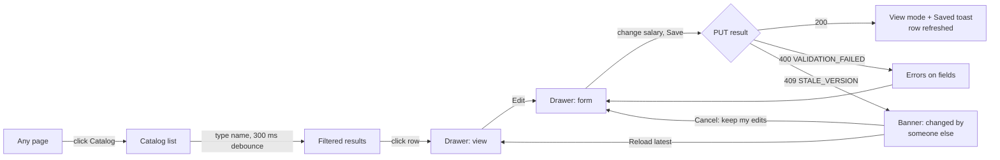
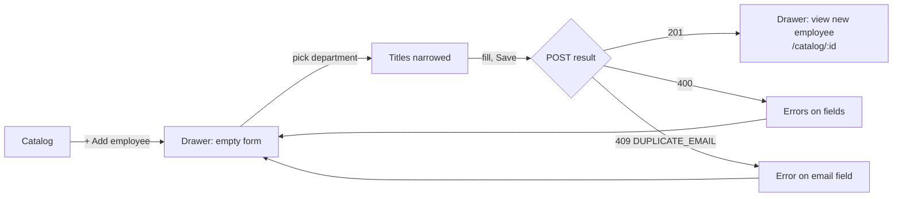
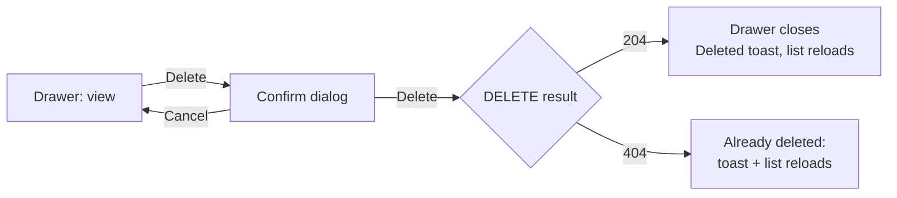
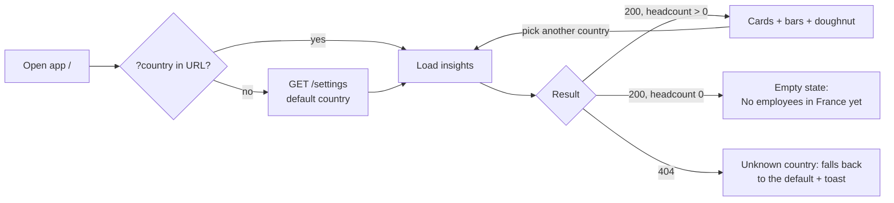
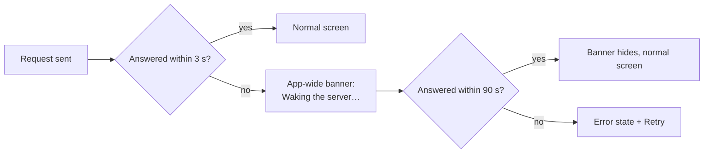

# UI Design

Screens, user flows and states for v1, designed in task 2.5. The decisions are in ADR-027 to ADR-029.
This is the source for phase 7: the API calls refer to [`openapi.yaml`](openapi.yaml), and the
structure to [`ARCHITECTURE.md`](ARCHITECTURE.md).

## Navigation and routes

```
+-----------------------------------------------------------------+
| Salary Management        [Insights]   Catalog            ⚙      |
+-----------------------------------------------------------------+
```

| Route | Screen | Notes |
|---|---|---|
| `/` | **Insights dashboard** (landing page) | `?country=IN`. Country order: URL, then the saved default, then IN |
| `/catalog` | Catalog: the employee list | Filters, search, sort and page are all in the query string |
| `/catalog/new` | Catalog + drawer, add form | |
| `/catalog/:id` | Catalog + drawer, employee view | Linkable. A missing or deleted id shows "not found" in the drawer |
| `/catalog/:id/edit` | Catalog + drawer, edit form | |
| `/settings` | Settings | The default country for the dashboard |
| `/health` | Phase 1 health page | Exists already; not in the top bar |

"Catalog" is the label and the URL. The code folder stays `employees/` (`CLAUDE.md`), and the API stays
`/api/v1/employees`.

## Screens

### Insights dashboard (`/`)

Desktop:
```
+-----------------------------------------------------------------+
| Salary Management        [Insights]   Catalog            ⚙      |
+-----------------------------------------------------------------+
| Country [India (INR)       v]                                   |
|                                                                 |
| +-----------+ +-----------+ +-----------+ +---------+ +--------+|
| | Headcount | | Median    | | Average   | | Min     | | Max    ||
| |   2,000   | | INR       | | INR       | | INR     | | INR    ||
| |           | |1,890,000.00| |2,150,000.37| |410,000.00| |9,800,000.00||
| +-----------+ +-----------+ +-----------+ +---------+ +--------+|
|                                                                 |
| Average salary by job title (INR)        | Headcount by dept    |
| Engineering Manager  ████████████ 5,8..  |     .---.            |
|                     Engineering · 40     |   /  2,000 \  ■ Eng  |
| Senior Software Eng. █████████  4,1..    |   \  total /    640 32%|
|                     Engineering · 180    |     '---'     ■ Sales|
| Software Engineer    ██████     2,4..    |                410 21%|
| ...                                      |   ...                |
+-----------------------------------------------------------------+
```

Phone (stacked):
```
+---------------------------+
| Salary Mgmt          ☰    |
+---------------------------+
| [India (INR)          v]  |
| +----------+ +----------+ |
| |Headcount | | Median   | |
| |  2,000   | |INR 1.89M…| |
| +----------+ +----------+ |
| +----------+ +----------+ |
| | Average  | | Min/Max  | |
| +----------+ +----------+ |
| Headcount by department   |
|        (doughnut)         |
|  ■ Engineering  640  32%  |
| Avg salary by job title   |
| Eng. Manager ████ 5.8M…   |
+---------------------------+
```

- **Stat cards** show headcount, median, average, min and max. Money is shown in full (see Formatting);
  on narrow cards, long values wrap rather than abbreviate.
- **Average by job title** is a table with inline CSS bars (no chart library). Each row has the title,
  a bar scaled to the highest average, the exact amount, and the department and headcount as a second
  line. Sorted by average, highest first (ADR-017).
- **Headcount by department** is a Chart.js doughnut (ADR-029). The total is in the centre, and the
  legend lists each department with count and percentage, because angles are hard to compare. Sorted
  by headcount, highest first.
- Changing the country updates `?country=` only. It does **not** change the saved default.

### Catalog (`/catalog`)

Desktop:
```
+---------------------------------------------------------------------------+
| Salary Management        Insights   [Catalog]                       ⚙     |
+---------------------------------------------------------------------------+
| [Search name or email___________] [Country v] [Department v] [Title v]    |
|                                                       [+ Add employee]    |
|---------------------------------------------------------------------------|
| Name ▲              Title            Dept         Ctry  Salary      Hired  |
| Asha Rao            Software Eng.    Engineering  IN    INR 2,400,000.00  2021-04-12 |
| asha.rao@acme.com                                                         |
| Ben Ode             QA Engineer      Engineering  GB    GBP 48,000.00     2019-11-02 |
| ben.ode@acme.com                                                          |
| ...                                                                       |
|---------------------------------------------------------------------------|
| 1–20 of 10,000                         [<] 1 2 3 … 500 [>]  [20 v]/page   |
+---------------------------------------------------------------------------+
```

Phone (rows become cards):
```
+---------------------------+
| Salary Mgmt          ☰    |
+---------------------------+
| [Search name or email___] |
| [Filters (2) v] [Sort v]  |
| [+ Add employee]          |
| +-----------------------+ |
| | Asha Rao              | |
| | Software Eng. · IN    | |
| | INR 2,400,000.00      | |
| +-----------------------+ |
| +-----------------------+ |
| | Ben Ode  ...          | |
| +-----------------------+ |
| [<]   Page 1 of 500   [>] |
+---------------------------+
```

- **Search** is debounced (300 ms) and only sent at 2+ characters (ADR-016). One character shows the
  hint "Type at least 2 characters" and keeps the previous results.
- **Filters** have one value each. Picking a department narrows the title dropdown to that
  department's titles. Clearing the department restores all titles.
- **Sortable columns** are name, salary and hire date. Clicking a header toggles asc/desc. Other
  columns are not sortable, matching the API whitelist.
- **Page size** is 20, 50 or 100. Changing it, or any filter, resets to page 1.
- **The URL holds everything:** `/catalog?q=asha&country=IN&department=Engineering&sort=salary,desc&page=0&size=20`.
  The URL's page is 0-based to match the API; the paginator displays it 1-based.
- On phones, filters collapse into a "Filters (n)" panel and sorting moves to a "Sort" dropdown.

### Employee drawer (`/catalog/:id`, `/catalog/new`, `/catalog/:id/edit`)

```
+----------------------------+          +----------------------------+
| Asha Rao                 x |          | Edit employee            x |
| asha.rao@acme.com          |          | Full name  [Asha Rao_____] |
|                            |          | Email      [asha.rao@ac..] |
| Software Engineer          |          | Department [Engineering v] |
| Engineering · India        |          | Job title  [Software En v] |
|                            |          | Country    [India       v] |
| INR 2,400,000.00           |          | Salary INR [2400000.00___] |
| Hired 2021-04-12           |          | Hire date  [2021-04-12 📅] |
|                            |          |                            |
| [Edit]          [Delete]   |          | [Cancel]           [Save]  |
+----------------------------+          +----------------------------+
          view                                 edit / add
```

- The drawer opens on the right over the list, and the list keeps its filters and scroll. On phones
  it is full-screen.
- **One form component for add and edit.** Add starts empty at `/catalog/new`.
- **Currency** is shown next to the salary input and follows the selected country. It is never an
  input (ADR-014).
- **The title dropdown depends on the department.** Changing department clears the title.
- **Client validation mirrors the API:**
  - Required fields.
  - A valid email.
  - Salary > 0 with at most 2 decimals.
  - Hire date between 1950-01-01 and today in UTC; the date picker disables other dates.
  - Text lengths.

  Server `VALIDATION_FAILED` errors are mapped onto the same fields.
- **After a save,** the drawer switches to view mode with a "Saved" toast, and the list row refreshes.
  After an add, it shows the new employee at `/catalog/:id`.
- **Unsaved changes:** closing the drawer with edits asks "Discard changes?".

### Delete confirmation

```
+------------------------------------------------+
| Delete Asha Rao?                               |
| They will disappear from the catalog and from  |
| insights.                                      |
|                          [Cancel]  [Delete]    |
+------------------------------------------------+
```

The Delete button is in the drawer only, not on every row. After a delete, the drawer closes, a
"Deleted" toast appears, and the list reloads on the same page (or the previous one, if this emptied
it). There is no undo, because restore is not exposed (ADR-011).

### Settings (`/settings`)

```
+---------------------------------------------+
| Settings                                    |
| Default country for Insights                |
| [India (INR)                v]   [Save]     |
| Currency follows the country.               |
+---------------------------------------------+
```

It uses `GET` / `PUT /api/v1/settings` (ADR-028). A stale save (409) shows "Settings were changed
elsewhere" and reloads them, since there is only one field to lose.

## User flows

### Find and update a salary (target: under 30 seconds)



That is 5 interactions (click, type, click, click, edit and save), each with a warm response under
200 ms (ADR-016).

### Add an employee



### Delete an employee



### View insights



### Cold start (any request)



## States

Every data view handles each state (`CLAUDE.md`). The cold-start banner applies app-wide, on top of
whichever state is showing.

| View | Loading | Empty | Error |
|---|---|---|---|
| Insights | Skeleton cards and bars | "No employees in {country} yet", with a link to the Catalog | "Couldn't load insights" + Retry |
| Catalog list | Skeleton rows; existing rows dim while a new page loads | No employees at all: "No employees yet" + Add. No matches: "No one matches these filters" + Clear filters | "Couldn't load employees" + Retry |
| Drawer view | Skeleton | — | 404: "This employee no longer exists" + Close |
| Drawer form | Save button spinner; inputs locked | — | Field errors; 409 banners (stale, duplicate email); other errors as a toast, with edits kept |
| Settings | Skeleton dropdown | — | "Couldn't load settings" + Retry |
| Reference data | Blocks forms and filters until loaded (once per session) | — | App-level error + Retry, since nothing works without it |

## Formatting

- **Money** uses the ISO code and the en-US style for every country: `INR 2,400,000.00`, `EUR 52,000.00`.
  Always 2 decimals, so mixed-country lists line up. Formatted with `Intl.NumberFormat('en-US')` in the
  money pipe. The UI never calculates with money (ADR-015).
- **Dates** use ISO format, `2021-04-12`, everywhere.
- **Counts** use en-US grouping: `10,000`.

## Responsive

| Width | Layout |
|---|---|
| ≥ 1024 px | As drawn: full table, drawer about 420 px on the right, dashboard in two columns |
| 640–1023 px | The table drops the department and hire date columns (they stay in the drawer); the drawer is wider; the dashboard is one column |
| < 640 px | Cards instead of table rows, filters in a panel, a full-screen drawer, stacked cards, and a ☰ menu for the top bar |
